<p align="center"></p>

# 面试搭子 · Interview Buddy

面试搭子是一款 Windows 面试智能体，支持 DeepSeek 咨询、个人知识库、求职进度，以及可在屏幕共享中隐藏的面试悬浮窗。

[下载安装](#下载安装) · [功能与截图](#功能与截图) · [快速启动](#快速启动) · [开发与测试](#开发与测试)

## 下载安装

1. 下载 [Windows x64 安装包](https://github.com/hao-wang1216/interview-buddy/releases/latest)，在发布页的 **Assets** 里选择 `InterviewBuddy-*-Windows-x64-Setup.exe`。
2. 双击安装，从开始菜单打开「面试搭子」。安装包已包含语音转写环境和模型，可以直接使用本地转写。
3. 需要咨询、参考回答或联网搜索时，在软件左下角设置里保存自己的 DeepSeek API Key。

安装包适用于 Windows 10 2004 及更新版本的 64 位系统。当前安装包未进行代码签名，可以用发布页附带的 SHA-256 文件核对。

## 功能与截图

以下截图均来自实际运行的面试搭子，统一使用「企业知识库大模型问答（RAG）」作为案例。公司、简历、网页和模型回复使用演示数据，实时转写来自合成语音。设置截图省略了本机数据目录。

### 1. 面试咨询

点击「新对话」直接提问，例如“我准备面试大模型应用岗，怎么介绍我做的企业知识库问答项目？”回复以流式方式显示。你可以在同一个对话里追问，也可以从侧边栏打开之前的对话。结合个人资料回答时，可以展开「资料出处」回看引用的经历。

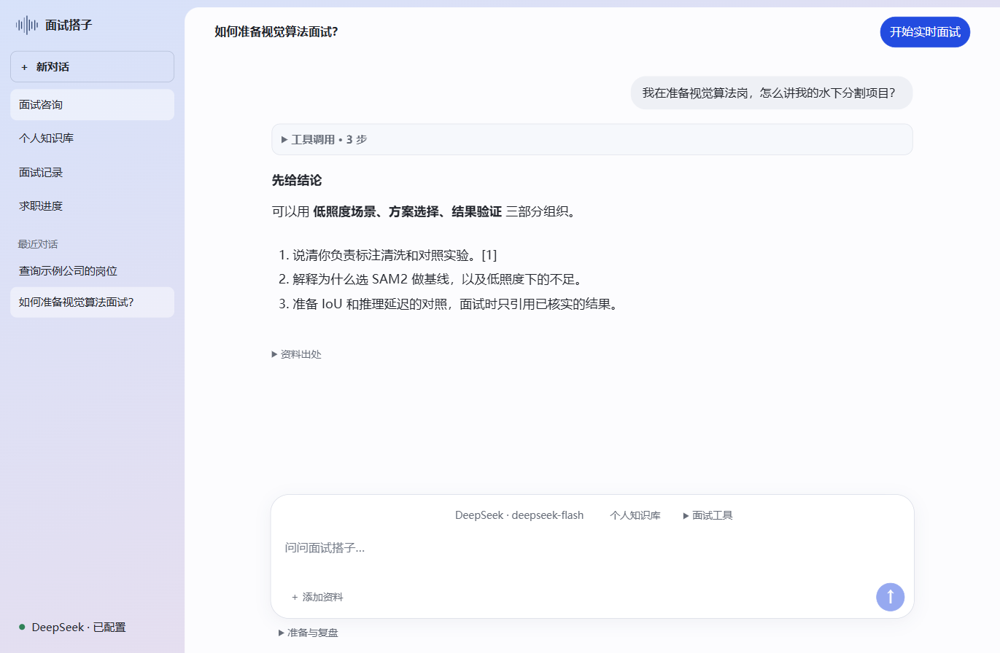

### 2. 面试工具与自动调用

直接提问时，DeepSeek 会判断是否需要调用工具。也可以从输入框上方的「面试工具」手动指定本轮优先使用的工具。

| 工具 | 用途 |
| --- | --- |
| 档案读取与个人知识库检索 | 读取面试语言、回答偏好和资料概况，检索相关的已确认经历。 |
| 岗位匹配 | 对照岗位描述和已有经历，找出匹配证据、准备缺口和优先事项。 |
| STAR 故事 | 将真实经历整理成情境、任务、行动、结果四部分，标明待补充的信息。 |
| 技术追问 | 围绕项目职责、方案取舍、失败边界和验证方法生成递进问题。 |
| 回答点评 | 检查回答是否切题、是否有证据，并给出口述改写建议。 |

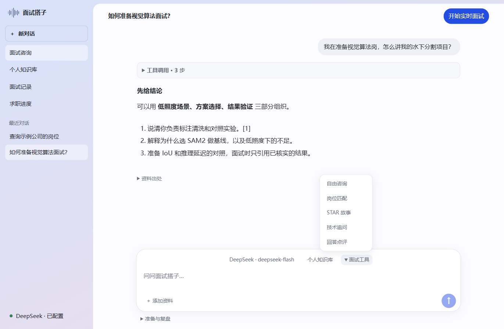

展开「工具调用」可以查看工具名称、执行顺序、状态和结果摘要。已完成回答的调用过程也会保留在面试记录中。

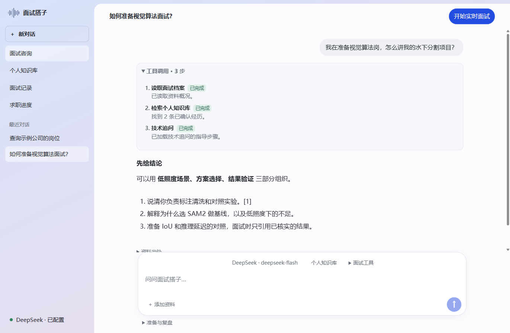

<details>
<summary>查看岗位匹配、STAR 故事和回答点评的实际界面</summary>

**岗位匹配**会分列已有证据和待补信息。示例中，RAG 检索和离线评估已有素材，上线并发、延迟预算和监控方式还需要补充。

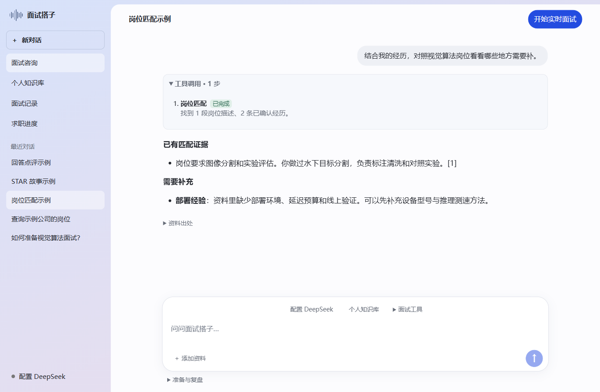

**STAR 故事**会把经历整理为情境、任务、行动和结果，方便直接练习口述。

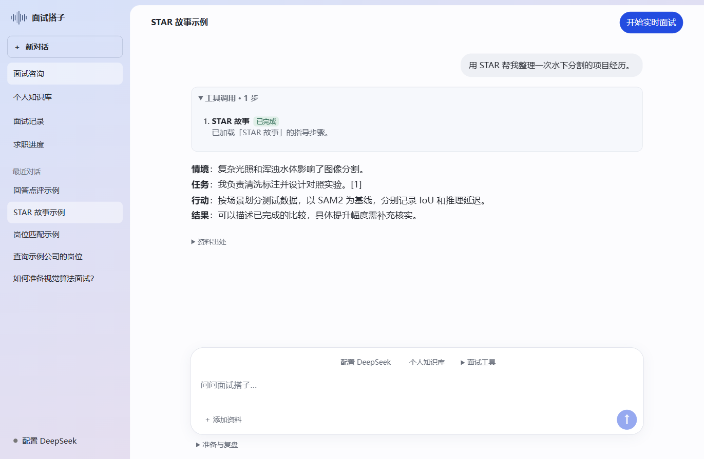

**回答点评**会指出原回答中缺少的关键信息，再给一段基于已确认材料的改写。

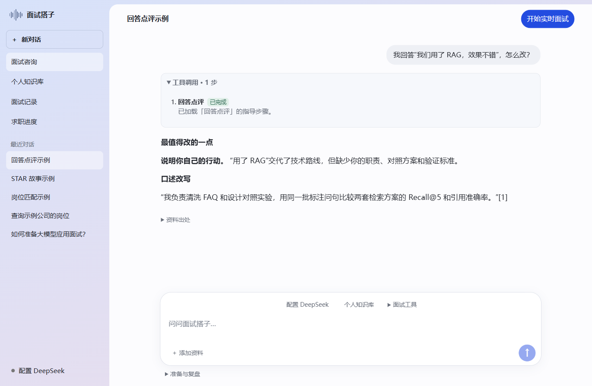

</details>

### 3. 联网搜索与网页来源

需要查公司近况、公开招聘信息等内容时，可以直接说“请网上查一下”。DeepSeek 可以先搜再答。正文用「网页 1」等编号标注出处，展开「网页来源」可打开原网页。搜索失败会在工具调用记录中显示原因。

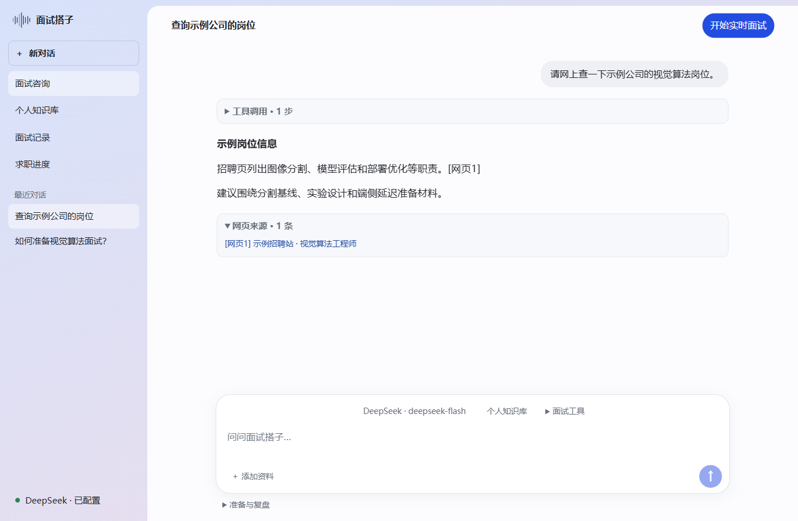

### 4. 个人知识库

可按简历、岗位描述和项目资料分类导入 TXT、Markdown 和含可选中文字的 PDF。支持关键词检索、查看原文片段和页码。你可以从片段手动建立档案，也可以用 DeepSeek 提取待确认的事实，核对后再用于咨询和面试回答。

- 单文件最大 50 MB，单份资料最多提取 24 万字符，PDF 最多 120 页。
- 扫描版 PDF 需先在外部做 OCR，再导入生成的可搜索 PDF。

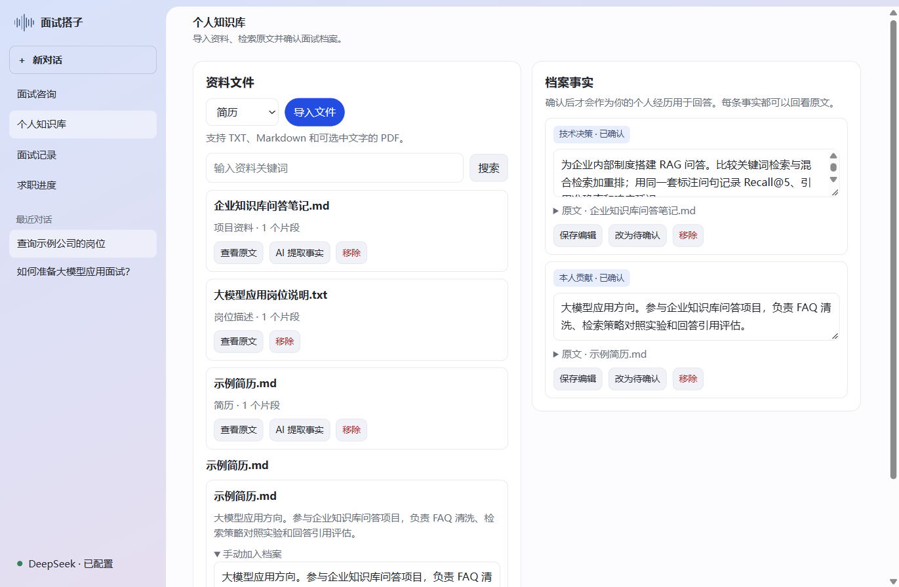

### 5. 准备计划、复盘与面试记录

在咨询页展开「准备与复盘」，可以整理面试档案、检查资料缺项或生成本场复盘。档案资料齐全且已配置 DeepSeek 时，准备计划还可以生成项目答辩卡。左侧「面试记录」可以回看已保存的咨询问答、实时转写、参考回答、工具结果和网页来源。

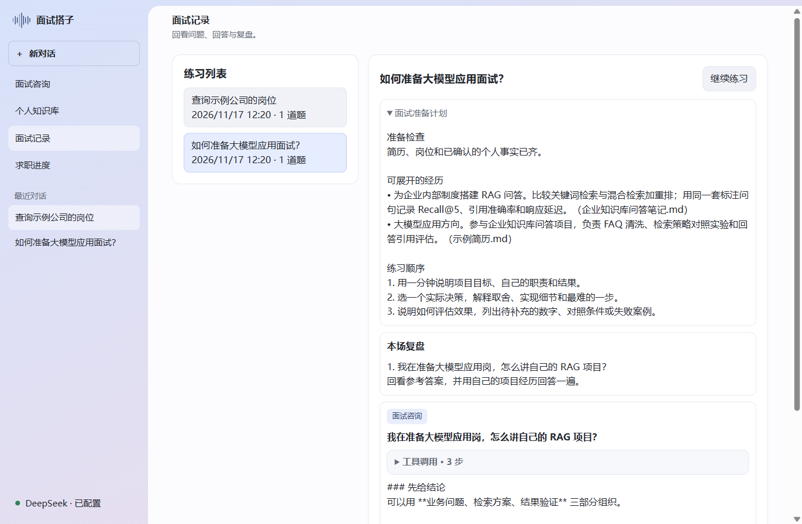

### 6. 求职进度表

添加公司、岗位、面试日期、轮次、状态和备注，记录面试题、反馈或下一轮的准备事项。支持编辑、删除和按状态筛选。每一轮面试可以单独记录。

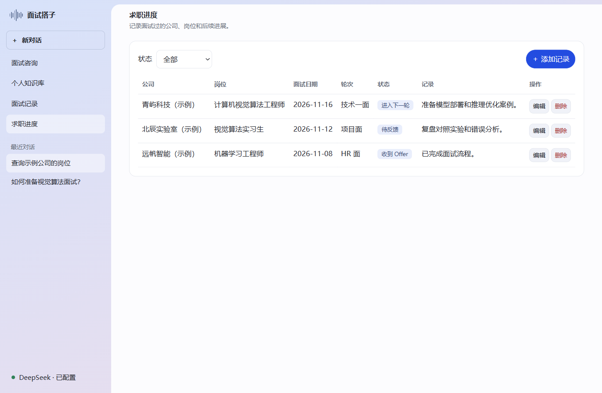

### 7. 实时语音转写与参考回答

点击「开始实时面试」，勾选「系统声音」「麦克风」或两者，再点「开始监听」。左侧区分声源显示转写，右侧接收参考回答。点击一条转写即可把它填进输入框；可以先修正错字，再提交给 DeepSeek。

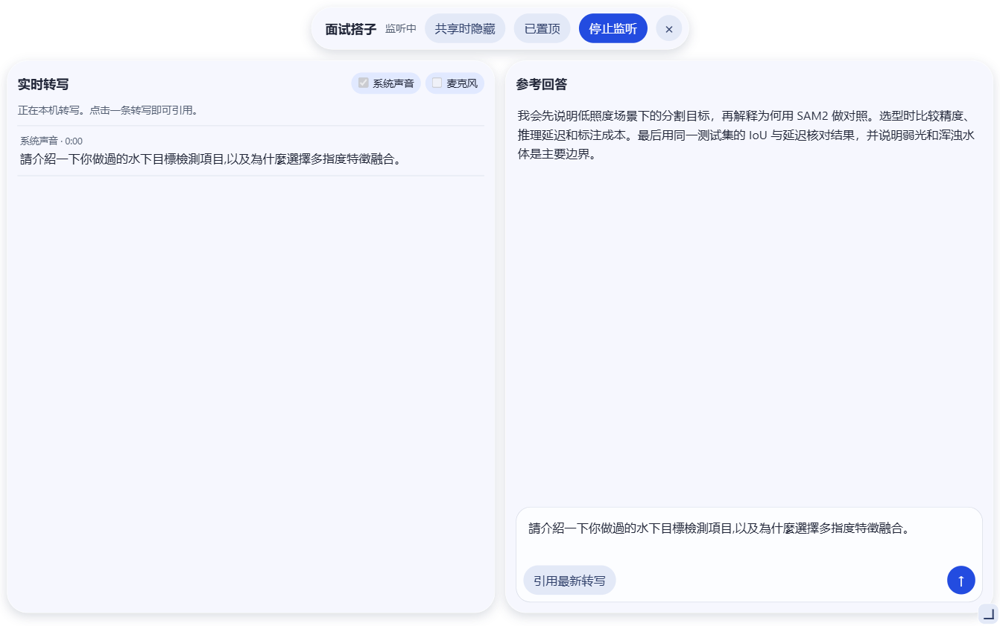

### 8. 悬浮窗缩放、置顶与共享可见性

拖顶部控制栏移动窗口，拖右下角改变大小。窗口缩窄时，转写和回答会自动上下排列，适合把悬浮窗挪到会议视频旁边。顶部按钮可取消置顶，也可以在「共享时隐藏」和「共享时可见」之间切换。

每次打开时默认「共享时隐藏」。Windows 10 2004 及更新版本的受支持捕获接口可以排除此窗口。会议软件的捕获方式可能不同，共享前可以通过会议软件的共享预览确认。

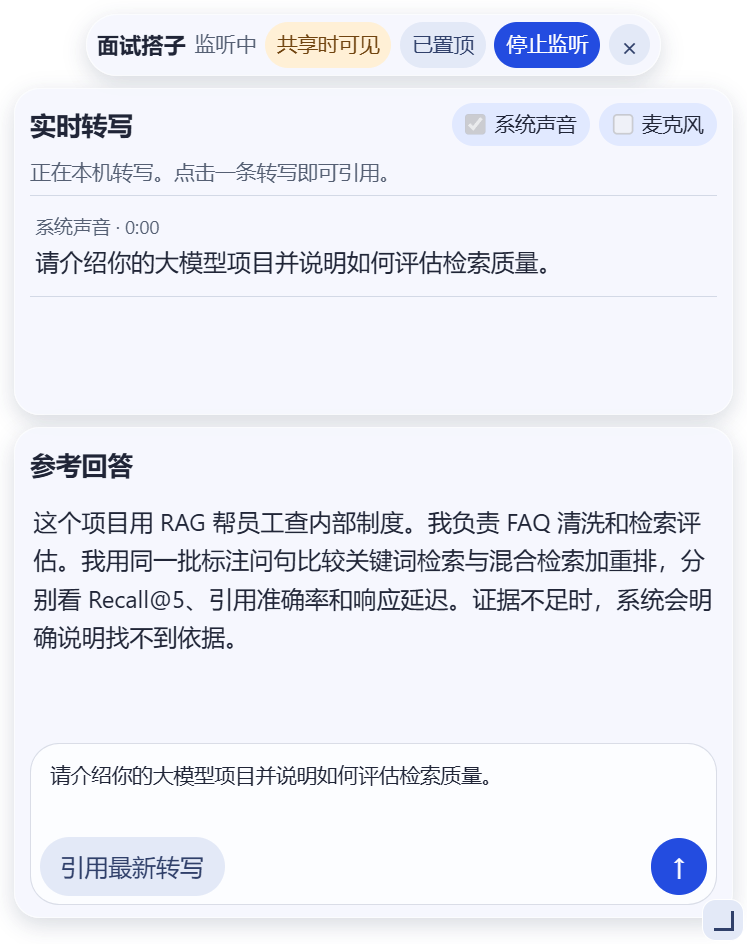

### 9. DeepSeek 与面试偏好

在左下角打开设置，可以保存、测试或移除 DeepSeek API Key，选择模型、面试语言，以及设置回答风格，例如“项目经历用 STAR 结构，回答控制在一分钟左右”。API Key 使用 Windows 系统加密保存在本机。

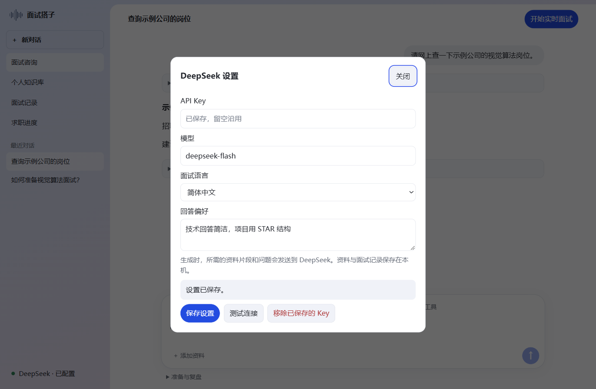

## 快速启动

需要 **Windows x64、Git 和 [Node.js](https://nodejs.org/) 24 或更新版本**。首次启动时运行：

```powershell
git clone https://github.com/hao-wang1216/interview-buddy.git
cd interview-buddy
npm ci
npm run start
```

首次构建后，也可双击 `Start-InterviewBuddy.cmd`。个人知识库和求职进度表可以直接使用。模型咨询、参考回答和联网搜索需要在软件内配置自己的 DeepSeek API Key。

### 配置本地语音转写

安装 [64 位 Python 3.12](https://www.python.org/downloads/windows/) 并加入 PATH，预留约 1 GB 空间。在仓库目录执行：

```powershell
python .\tools\provision-speech.py
```

脚本会在项目目录创建独立的 Python 环境，安装 faster-whisper，并下载 [Whisper Small 多语言模型](https://huggingface.co/Systran/faster-whisper-small) 到 `.runtime/speech`。安装后转写可离线运行。麦克风使用 Windows 的默认输入，系统声音来自当前播放设备。

## 数据与隐私

导入资料的文字、已确认事实、转写文字、工具调用摘要和求职进度保存在本机。生成回答时，当前问题、相关对话和检索到的资料片段会按需发给 DeepSeek。联网搜索的成功请求按 DeepSeek 的搜索费率计费。[DeepSeek 搜索说明](https://api-docs.deepseek.com/guides/search/)

## 开发与测试

- `npm test` 编译源码并验证本地存储、PDF 提取、引用和模拟 DeepSeek 工具调用。
- `npm run test:desktop` 使用临时数据目录自动操作 Windows 界面。
- 若要同时检查系统声音、实时转写和捕获保护，将 `BUDDY_TEST_WAV` 设为本机中文 WAV 文件的路径，并将 `BUDDY_TEST_EXPECTED` 设为录音中便于识别的词，例如“大模型”。然后运行桌面测试。
- 要测试已安装的版本，可将 `BUDDY_TEST_EXECUTABLE` 指向安装目录中的 `InterviewBuddy.exe`，再运行桌面测试。测试使用独立的临时数据目录。

发布用安装包由 `tools/build-windows-installer.ps1` 构建，需要 Inno Setup 6、与依赖锁定版本匹配的 Electron Windows x64 分发目录，以及带依赖和 Whisper Small 的 Windows x64 嵌入式 Python 3.12 运行时。脚本的 `-SpeechRuntime` 接受包含 `python` 和 `whisper-small` 的独立目录。

源码依赖 [Electron](https://github.com/electron/electron)、[PDF.js](https://github.com/mozilla/pdf.js)、[faster-whisper](https://github.com/SYSTRAN/faster-whisper) 和 [Whisper Small 的 CTranslate2 权重](https://huggingface.co/Systran/faster-whisper-small)。面试工具参考了 [interview-skill](https://github.com/shengxuan-create/interview-skill)、[interview-my-project](https://github.com/WarlCang/interview-my-project) 和 [Tech Interview Handbook](https://github.com/yangshun/tech-interview-handbook) 的公开方法。

## 许可证

面试搭子源码使用 [MIT 许可证](LICENSE)。第三方程序和模型分别适用其上游许可证。
